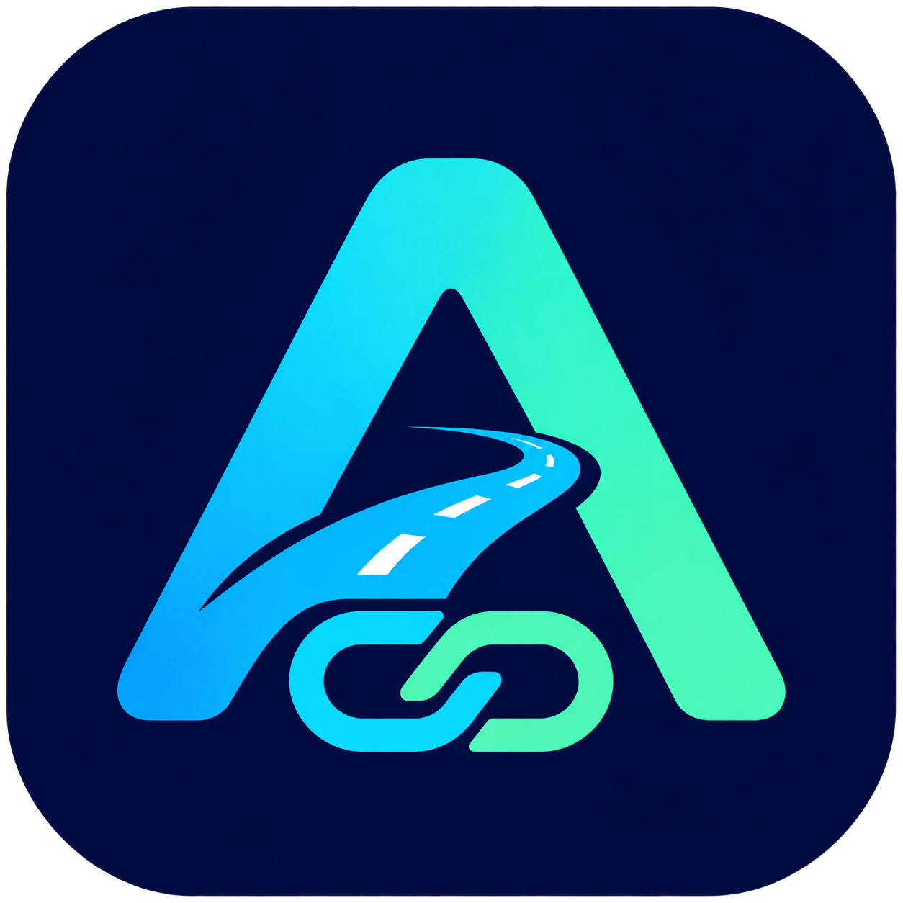
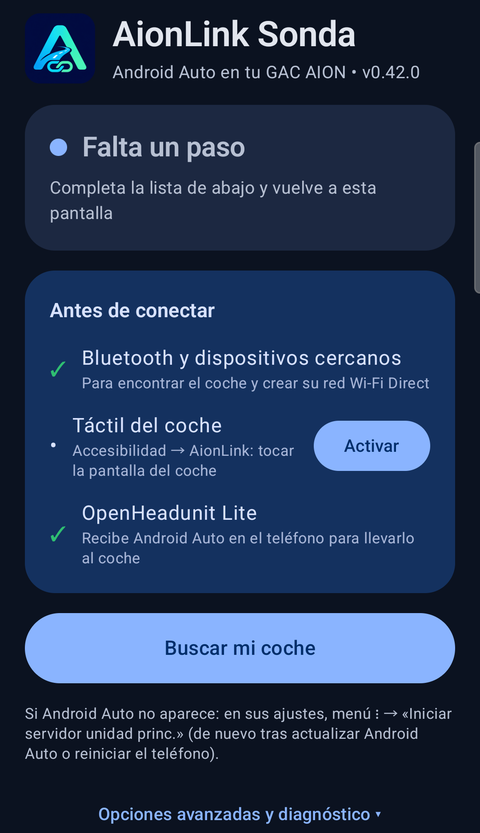
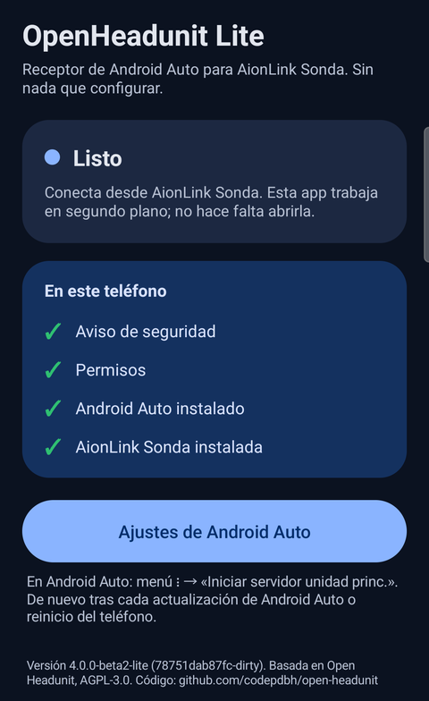

<p align="center">
  
</p>

<h1 align="center">AionLink Open</h1>

<p align="center">
  <strong>Android Auto y la pantalla de tu teléfono en un GAC AION con ICCOA CarLink.</strong><br />
  Un cliente Android independiente y de código abierto. Sin root, sin apps del fabricante.
</p>

<p align="center">
  <a href="LICENSE"></a>
  
  
  
  <a href="docs/PROGRESS.md"></a>
</p>

<p align="center">
  <a href="#qué-hace">Qué hace</a> ·
  <a href="#estado">Estado</a> ·
  <a href="#usarlo">Usarlo</a> ·
  <a href="#compilar">Compilar</a> ·
  <a href="#cómo-funciona">Cómo funciona</a> ·
  <a href="#documentación">Documentación</a>
</p>

---

## Qué hace

El GAC AION i60 solo ofrece **ICCOA CarLink**, un protocolo chino de proyección que
los teléfonos internacionales no traen. AionLink Open implementa el lado del teléfono
de ese protocolo con APIs públicas de Android y lleva al coche:

- **Android Auto**, a través de [OpenHeadunit Lite](#openheadunit-lite), con la
  pantalla del teléfono apagada.
- **La pantalla del teléfono** (modo espejo), con toque y sonido.
- **Un panel propio** con reloj, música y la indicación de Maps o Waze, también con
  la pantalla apagada.

```text
Galaxy S25 Ultra                                              GAC AION i60
┌────────────────────────────┐   Wi-Fi Direct + ICCOA    ┌──────────────────┐
│ Android Auto               │                           │                  │
│   ↓ (servidor de unidad    │   vídeo H.264 1920x960    │  Pantalla        │
│      principal, local)     │ ────────────────────────► │  CarLink         │
│ OpenHeadunit Lite          │   audio AAC 48 kHz        │                  │
│   ↓ superficie + audio     │                           │                  │
│ AionLink Sonda ────────────┼──◄────── toques (UIBC) ───┤                  │
└────────────────────────────┘                           └──────────────────┘
```

Vehículo de referencia: **GAC AION i60 REEV Platinum** (unidad ADiGO, firmware
`GAC_T51_IDC_S003_260310_0742921_R`). Teléfono de referencia: **Samsung Galaxy S25
Ultra** internacional con Android 17.

<p align="center">
  
  &nbsp;&nbsp;
  
</p>

## Estado

Cada fila indica **cómo** se comprobó: en el coche, solo en el teléfono, o por
informe del propietario. El detalle con hashes y fechas está en
[docs/PROGRESS.md](docs/PROGRESS.md).

| Función | Estado | Evidencia |
|---|---|---|
| Sesión ICCOA: BLE, Wi-Fi Direct, AUTH, CONTROL, RTSP | ✅ Funciona | En el AION desde 0.25 |
| Espejo 1920x960 a 30 fps con audio AAC y toque | ✅ Funciona | En el AION con 0.34: 11 Mbps, 31 fps, 6175 tramas AAC, 351/351 toques |
| Android Auto por OpenHeadunit Lite (vídeo, audio, reconexión) | ✅ Funciona | En el teléfono (0.42): 24–28 fps, audio real, 5/5 reconexiones; el propietario informa que funciona |
| Android Auto con la pantalla apagada | ✅ Funciona | En el teléfono: 20 fps estables con la pantalla apagada |
| Toque de Android Auto en el coche | 🟡 Implementado | Pendiente de diagnóstico del coche |
| Panel propio con la pantalla apagada | 🟡 Implementado | Codificación medida 10 min en el teléfono |
| Conexión por cable USB/AOA | 🧪 Experimental | Sin autenticación con el AION |

No se declara compatibilidad con otros vehículos ni teléfonos. Las versiones
publicadas son de investigación (`-research`).

## Usarlo

### Lo que necesitas

1. **AionLink Sonda** (`org.aionlink.open.lab`), compilada desde este repositorio.
2. **OpenHeadunit Lite** (`org.aionlink.headunit.lite`), compilada desde la rama
   `main` del [fork de Open Headunit](https://github.com/codepdbh/open-headunit).
3. **Las dos firmadas con la misma clave.** El puente entre ellas usa un permiso
   `signature`; con claves distintas, Android no deja que se comuniquen.
4. **Android Auto** con el modo desarrollador activo. En sus ajustes, menú ⋮ →
   **Iniciar servidor unidad princ.** Repítelo después de cada actualización de
   Android Auto y de cada reinicio del teléfono.

### Primera vez en un teléfono

Abre **AionLink Sonda**. Si falta algo, la tarjeta **Antes de conectar** lo muestra
con un botón para resolverlo:

- **Bluetooth y dispositivos cercanos**: para encontrar el coche y crear su red Wi-Fi Direct.
- **Táctil del coche**: el servicio de accesibilidad que aplica los toques de la
  pantalla del coche. Android puede desactivarlo al actualizar la app; si pasa, la
  tarjeta vuelve a aparecer.
- **OpenHeadunit Lite** instalada.

Abre una vez **OpenHeadunit Lite**, lee y acepta el aviso de seguridad y concede los
permisos. A partir de ahí trabaja en segundo plano; no hay nada que configurar.

### Conectar

1. Con el coche **estacionado**, abre CarLink en la pantalla del coche.
2. En AionLink Sonda pulsa **Buscar mi coche** y luego **Conectar** junto al receptor.
3. Introduce el código que muestra el coche.
4. Android Auto aparece en la pantalla del coche. Puedes apagar la pantalla del teléfono.

Los modos espejo y panel, la calidad de imagen, las pruebas sin coche, la conexión
USB y la exportación del diagnóstico están en **Opciones avanzadas y diagnóstico**.

> **Seguridad:** no manipules el teléfono ni la app mientras conduces. Las pruebas
> nuevas se hacen con el coche estacionado.

## Compilar

### Requisitos

- Windows con Android Studio (su JDK, en `jbr`) y Android SDK.
- Python 3 para las herramientas de análisis y las pruebas.

Versiones fijadas: **Gradle 8.13**, **AGP 8.9.1**, **Kotlin y Compose 2.1.20**,
minSdk 29, compile/target SDK 35.

### AionLink Sonda

```powershell
git clone https://github.com/codepdbh/aionlink-open.git
cd aionlink-open\android
$env:JAVA_HOME = 'C:\Program Files\Android\Android Studio\jbr'
$env:ANDROID_HOME = "$env:LOCALAPPDATA\Android\Sdk"
./gradlew.bat testDebugUnitTest :app:assembleDebug :app:lintDebug -PaionlinkLab
adb install -r app\build\outputs\apk\debug\app-debug.apk
```

Sin `-PaionlinkLab` se compila **AionLink Open** (`org.aionlink.open`), la variante
principal. El script `scripts/Build-Android.ps1` ejecuta las pruebas, el lint y copia
la APK a `artifacts/builds/`.

**Firma compartida.** Para que las APK de distintos PC actualicen la misma app
instalada, crea `android/keystore.properties` (nunca se sube a Git) con `storeFile`,
`storePassword`, `keyAlias` y `keyPassword`. Usa esa misma clave para OpenHeadunit Lite.

### OpenHeadunit Lite

```powershell
git clone https://github.com/codepdbh/open-headunit.git
cd open-headunit
./gradlew.bat :app:assembleLiteDebug
```

La variante `lite` está en `app/src/lite/` del fork. El mismo cambio está guardado
aquí como parche: [patches/open-headunit/openheadunit-lite.patch](patches/open-headunit/openheadunit-lite.patch).

## OpenHeadunit Lite

Una edición de [Open Headunit](https://github.com/andreknieriem/open-headunit)
(AGPL-3.0) dedicada a AionLink Sonda. Se instala junto a la app completa:

- **Ajustes fijos** en cada arranque: solo modo autónomo, 1080p, H.264, 30 fps,
  horizontal, audio hacia AionLink.
- **Una sola pantalla**: estado, aviso de seguridad, permisos y detener sesión.
- **Puente de superficie**: AionLink le entrega la superficie de su codificador y
  una tubería de audio. Lite decodifica Android Auto directamente en ella y
  devuelve PCM de 48 kHz, sin pantalla virtual ni privilegios de sistema.
- **Reconexión rápida**: al volver a conectar fuerza un fotograma completo y la
  imagen vuelve en ~1,6 s.
- **Más ligera**: solo arm64-v8a, español e inglés, sin funciones de launcher,
  navegación ni USB.

AionLink no incluye código de Open Headunit ni gestiona la autenticación de Android
Auto; solo se comunica con Lite por el puente documentado.

## Cómo funciona

```text
android/
├── app/                   Pantalla, sesión de proyección, puente con OpenHeadunit Lite
├── core/                  Estados de sesión
├── protocol-api/          Contratos independientes del fabricante
├── protocol-iccoa/        AUTH ICCOA: HKDF, AES-GCM y tramas UCar
├── transport-bluetooth/   Descubrimiento BLE e intercambio inicial
├── transport-wifi/        Wi-Fi Direct, AUTH y canal CONTROL cifrado
├── transport-usb/         AOA experimental
├── projection/            Fuente Wi-Fi Display: RTSP, MPEG-TS/RTP, UIBC
└── vehicle-profiles/      Perfiles y evidencia por vehículo
```

1. **Descubrimiento y enlace.** BLE encuentra el receptor ICCOA; con el código del
   coche se forma la red Wi-Fi Direct.
2. **Autenticación.** AUTH por TCP con clave de sesión derivada (ECDH + HKDF-SHA256)
   y confirmación cifrada con AES-GCM.
3. **Control.** Canal CONTROL cifrado con latidos y servidores MEDIA/SENSOR.
4. **Vídeo y audio.** El coche negocia Wi-Fi Display por RTSP. AionLink codifica
   H.264 a la resolución del coche (1920x960) y AAC-LC, y los envía en MPEG-TS sobre RTP.
5. **Toque.** El coche envía UIBC: va a Android Auto por el puente o a la pantalla
   del teléfono por accesibilidad.

Explicación por versiones en [docs/protocol-research/](docs/protocol-research/).

## Investigación reproducible

Las APK de investigación se obtienen por separado y se mantienen **solo en local**
(`extracted/` y `analysis/` están excluidas de Git). El repositorio contiene
automatización propia y reportes de hallazgos; no redistribuye aplicaciones ni
código de fabricantes.

```powershell
powershell -NoProfile -ExecutionPolicy Bypass -File scripts/Prepare-Tools.ps1
python scripts/analyze_apks.py
python scripts/inspect_native.py
python scripts/generate_reports.py
```

Consulta [uso de herramientas](docs/troubleshooting/TOOLS.md) y la
[política de investigación](docs/legal/REVERSE_ENGINEERING_POLICY.md).

## Ruta de desarrollo

- [x] Descubrimiento BLE, enlace Wi-Fi Direct y AUTH ICCOA con el AION.
- [x] Proyección del teléfono a 1920x960 con audio y toque, verificada en el AION.
- [x] Panel propio y codificación con la pantalla apagada.
- [x] Android Auto por OpenHeadunit Lite, con audio y reconexión.
- [x] Pantallas simplificadas e icono propio (0.42).
- [ ] Diagnóstico archivado de Android Auto en el AION: imagen, audio y toque.
- [ ] Medir consumo y estabilidad en viajes largos.
- [ ] Conexión por cable completa.
- [ ] Versión firmada para instalar sin compilar.

## Documentación

| Guía | Contenido |
|---|---|
| [Progreso](docs/PROGRESS.md) | Registro por versión: cambios, pruebas, hashes y pendientes |
| [Pruebas](docs/TESTING.md) | Verificación automatizada y en hardware |
| [Arquitectura](docs/architecture/SYSTEM_ARCHITECTURE.md) | Módulos, estados y límites |
| [AUTH 0.17](docs/protocol-research/AUTH_CONFIRM_017.md) | Secuencia, workModes, clave de sesión y AuthConfirm |
| [Proyección 0.18](docs/protocol-research/PROJECTION_018.md) | CONTROL cifrado, Wi-Fi Display, TS/RTP y captura |
| [Toque y audio 0.19](docs/protocol-research/TOUCH_AUDIO_019.md) | UIBC por accesibilidad, AAC, MEDIA/SENSOR |
| [RTP sobre TCP 0.20](docs/protocol-research/RTP_TCP_020.md) | Bloqueo en M3 y sink del coche |
| [Nitidez 0.34](docs/protocol-research/QUALITY_PROBE_034.md) | Resolución del coche, bitrate y pantalla apagada |
| [Modo coche 0.35](docs/protocol-research/CAR_MODE_035.md) | Panel propio y primera vía a Android Auto |
| [Open Headunit 0.36](docs/protocol-research/OPEN_HEADUNIT_DISPLAY_036.md) | Pantalla virtual y por qué se pasó al puente de superficie |
| [Investigación ICCOA](docs/protocol-research/ICCOA_RESEARCH.md) | Evidencia estática y modelo del protocolo |
| [Formato UCar](docs/protocol-research/UCAR_OBSERVED_FORMAT.md) | Cabecera de tramas observada |
| [Preguntas abiertas](docs/protocol-research/OPEN_QUESTIONS.md) | Incertidumbres y próximos experimentos |
| [Compatibilidad](docs/compatibility/VEHICLES.md) | Vehículos y funciones verificados |

## Contribuir

Son útiles los reportes reproducibles con versión, pasos y resultado observado,
separando hechos, inferencias e hipótesis.

```powershell
python -m unittest discover -s tests/unit -v
./scripts/Build-Android.ps1
```

No adjuntes APK propietarias, código descompilado, claves, tokens, VIN, direcciones
Bluetooth ni capturas con datos personales. Anonimiza los registros antes de compartirlos.

## Licencia e independencia

El código original de AionLink se distribuye bajo **[GPL-3.0-or-later](LICENSE)**.
OpenHeadunit Lite es una variante de Open Headunit y conserva su licencia
**AGPL-3.0** en su propio repositorio. El icono es del autor del proyecto.

Proyecto independiente, sin afiliación con GAC, AION, Samsung, Google, ICCOA ni
Open Headunit. Android Auto es una marca de Google LLC. ICCOA CarLink no debe
confundirse con CarLife, Carlinkit, Android Auto o Apple CarPlay.
