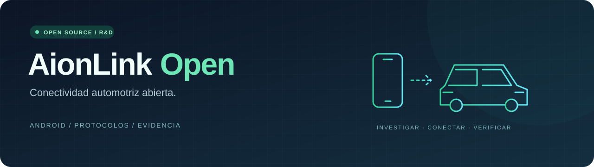

<p align="center">
  
</p>

<p align="center">
  <strong>Investigar. Conectar. Verificar.</strong><br />
  Una plataforma Android independiente para construir conectividad automotriz abierta.
</p>

<p align="center">
  <a href="LICENSE"></a>
  
  
  <a href="docs/PROGRESS.md"></a>
</p>

<p align="center">
  <a href="#qué-funciona-hoy">Qué funciona</a> ·
  <a href="#compilar-en-windows">Compilar</a> ·
  <a href="#ruta-de-desarrollo">Roadmap</a> ·
  <a href="#documentación">Documentación</a> ·
  <a href="#contribuir">Contribuir</a>
</p>

---

## Una conexión que podamos entender

AionLink Open investiga cómo conectar un teléfono Android internacional al receptor
**ICCOA CarLink** de un vehículo mediante un cliente independiente, APIs públicas
y autenticación legítima.

El primer vehículo de investigación es un **GAC AION i60 REEV Platinum**, con unidad
ADiGO y firmware `GAC_T51_IDC_S003_260310_0742921_R`. El teléfono inicial es un
**Samsung Galaxy S25 Ultra internacional**.

```text
Galaxy S25 Ultra  →  AionLink Open  →  Receptor ICCOA  →  AION i60
                     Objetivo de interoperabilidad
```

> **Estado actual: experimental.** Hay una APK debug compilada e instalada en el
> teléfono de pruebas. Incluye descubrimiento Bluetooth, conexión GATT de inspección
> bajo selección del usuario, transporte USB/AOA experimental y diagnósticos.
> **La sesión ICCOA y la proyección en el AION todavía no están verificadas.**
> Encontrar un dispositivo o emparejar Bluetooth no demuestra una sesión.

## Qué funciona hoy

| Área | Implementado | Estado |
|---|---|---|
| Aplicación Android | Kotlin, Jetpack Compose, Material 3 y ViewModel | Compilada e instalada |
| Descubrimiento | Búsqueda Bluetooth Classic/BLE de 15 segundos; permisos bajo demanda | Pendiente de validación física del descubrimiento |
| Enlace BLE | Conexión al vehículo seleccionado, descubrimiento GATT y cierre | Implementado en 0.3; prueba con AION pendiente |
| USB + Bluetooth | Detección AOA, permiso, apertura y canales USB iniciales opcionales | Implementado en 0.4; autenticación y AION pendientes |
| Diagnóstico | Estado, permisos, eventos y exportación sin nombres ni MAC | Implementado |
| Análisis local | Hashes, firmas públicas, manifiestos, componentes, DEX y bibliotecas | Ejecutado sobre seis APK, incluidas dos versiones Samsung |
| Investigación ICCOA | Rutas estáticas BLE, Wi-Fi P2P, autenticación y JNI localizadas | Sin validación con receptor real |
| Sesión y proyección | Negociación, audio, vídeo y control | Pendientes |

**Validación local de v0.4:** 6 pruebas Python y 23 pruebas JVM aprobadas; compilación debug
correcta; lint con 0 errores y 8 advertencias. Estos resultados verifican componentes
propios, no compatibilidad con el vehículo.

## Compilar en Windows

### Requisitos

- Python 3 y JDK 21.
- Android SDK: plataforma API 35 y Build Tools 35.0.0.
- Acceso a los repositorios de dependencias de Gradle.

Incluye **Gradle Wrapper 8.13**, **AGP 8.9.1**, **Kotlin y Compose Compiler 2.1.20**.
Android mínimo: API 29; compile/target SDK: 35. Son versiones fijadas para reproducir
la compilación existente.

```powershell
git clone https://github.com/codepdbh/aionlink-open.git
cd aionlink-open

# Android Studio en su ubicación habitual:
powershell -NoProfile -ExecutionPolicy Bypass -File scripts/Build-Android.ps1
```

Para otras ubicaciones:

```powershell
./scripts/Build-Android.ps1 -JavaHome 'C:\ruta\jdk-21' -Sdk 'C:\ruta\Android\Sdk'
```

El script ejecuta las pruebas JVM, compila la aplicación, corre lint y copia la APK a:

```text
artifacts/builds/aionlink-open-debug.apk
```

### Instalar nuestra APK

Con el teléfono propio conectado y autorizado para depuración USB:

```powershell
adb devices -l
adb -s <serial-del-telefono> install -r artifacts/builds/aionlink-open-debug.apk
```

Abre **AionLink Open → Buscar dispositivos Bluetooth** y concede los permisos al
solicitarlos. Android 10–11 requiere ubicación para el descubrimiento; Android 12+
usa dispositivos cercanos. `neverForLocation` puede filtrar algunos anuncios BLE.

La búsqueda muestra dispositivos con identificadores temporales. No identifica
automáticamente al AION. En 0.3 puedes seleccionar el BLE de tu coche, confirmar
**Conectar y comprobar servicios** y obtener el inventario de UnionShare. El enlace
se cierra al finalizar; no inicia emparejamiento ni negociación ICCOA. Las pruebas
junto al vehículo deben hacerse con el coche estacionado.

### Conexión por cable (0.4)

Abre ICCOA en el vehículo estacionado y conecta el teléfono a su puerto de datos.
Si Android muestra un selector de aplicación para el accesorio, elige AionLink Open.
También puedes abrirla manualmente y pulsar **Actualizar USB**. Se requiere que el
receptor inicie AOA; conectar por carga/ADB no demuestra ese modo.

Con un accesorio visible, **Abrir USB y observar** solicita permiso y abre un canal
durante 15 segundos sin enviar mensajes. Para el identificador observado
ICCOA/CarLink/1.0.0 aparece **Iniciar canales USB (experimental)**: envía sólo las
solicitudes estáticas iniciales RTSP/UIBC estudiadas en Samsung y observa respuestas.
Ninguna opción completa todavía autenticación o proyección. Exporta el diagnóstico
al finalizar. Bluetooth se mantiene disponible; su papel exacto en la ruta cableada
no está verificado y no se empareja automáticamente.

## Arquitectura modular

```text
android/
├── app/                   Interfaz, permisos y diagnóstico
├── core/                  Coordinación y estados de sesión
├── protocol-api/          Contratos independientes del fabricante
├── protocol-iccoa/        Adaptador de investigación; devuelve Unsupported
├── transport-bluetooth/   Descubrimiento Classic y BLE
├── transport-usb/         AOA experimental, permisos y lectura de canales
├── transport-wifi/        Pendiente: topología y transporte Wi-Fi
├── projection/            Pendiente: medios sobre sesión verificada
└── vehicle-profiles/      Perfiles y evidencia por vehículo
```

La versión 0.2 añade indicios pasivos por UUID ICCOA/UnionShare y un lector offline
de cabeceras UCar con CRC y límites de tamaño. Los ejemplos de prueba son sintéticos;
no son capturas del vehículo ni demuestran interoperabilidad.

La UI no puede declarar una sesión establecida a partir del descubrimiento. Los
transportes, la negociación y los perfiles están separados para incorporar futuros
vehículos según evidencia de protocolo y capacidades.

## Investigación reproducible

Las APK de investigación se obtienen por separado y se mantienen **sólo en local**.
El repositorio incluye automatización original y reportes de hallazgos técnicos;
no redistribuye aplicaciones o código de fabricantes.

```powershell
# Herramientas oficiales con versiones y SHA-256 fijados
powershell -NoProfile -ExecutionPolicy Bypass -File scripts/Prepare-Tools.ps1
powershell -NoProfile -ExecutionPolicy Bypass -File scripts/Inspect-Environment.ps1

# Coloca tus APK legítimas en la raíz o en apks/original/
python scripts/analyze_apks.py
python scripts/inspect_native.py
python scripts/generate_reports.py
```

Apktool y JADX generan salidas separadas por hash, con registros de errores. Los
métodos que JADX no reconstruye requieren inspección de Smali. Las coincidencias de
palabras clave localizan código; por sí solas no confirman el funcionamiento del protocolo.

Consulta [uso de herramientas](docs/troubleshooting/TOOLS.md) para rutas distintas,
descompilación dirigida, comparación de versiones y tratamiento de fallos.

## Ruta de desarrollo

- [x] Preparar herramientas y verificar la integridad de descargas.
- [x] Inventariar las cinco APK disponibles y extraer sus manifiestos.
- [x] Construir la base Android con descubrimiento y diagnósticos.
- [x] Compilar e instalar la APK propia en el teléfono de pruebas.
- [ ] Completar el análisis semántico y obtener evidencia del receptor ICCOA concreto.
- [ ] Observar el AION y validar el transporte de descubrimiento.
- [ ] Documentar y negociar una sesión ICCOA legítima.
- [ ] Validar proyección real y medir estabilidad y latencia.
- [ ] Preparar una versión de la aplicación con compatibilidad comprobada.

La publicación del código no equivale a una versión funcional de proyección.
Consulta el [progreso detallado](docs/PROGRESS.md).

## Documentación

| Guía | Contenido |
|---|---|
| [Arquitectura](docs/architecture/SYSTEM_ARCHITECTURE.md) | Módulos, estados y límites |
| [Investigación ICCOA](docs/protocol-research/ICCOA_RESEARCH.md) | Evidencias estáticas y modelo provisional |
| [Diagnóstico S25](docs/protocol-research/S25_DIAGNOSIS.md) | Fallos OEM observados por ADB y sus límites |
| [Formato UCar](docs/protocol-research/UCAR_OBSERVED_FORMAT.md) | Cabecera y UUID observados; sin sesión verificada |
| [Comparación de rutas](docs/protocol-research/PROTOCOL_COMPARISON.md) | Samsung, Xiaomi, OPPO y CarLife |
| [Cliente de enlace](docs/protocol-research/ICCOA_CONNECTION_TRACK.md) | Enlace GATT, prueba 0.3 y ruta hacia interfaz propia |
| [USB/AOA](docs/protocol-research/USB_AOA_OBSERVED.md) | Rutas cableadas Samsung/CarWith y cliente 0.4 |
| [Preguntas abiertas](docs/protocol-research/OPEN_QUESTIONS.md) | Incertidumbres y próximos experimentos |
| [Informe APK](analysis/reports/APK_ANALYSIS_REPORT.md) | Paquetes, versiones, firmas y extracción |
| [Bibliotecas nativas](analysis/reports/NATIVE_LIBRARIES_REPORT.md) | Inventario y análisis ELF |
| [Compatibilidad](docs/compatibility/VEHICLES.md) | Vehículos y funciones realmente verificados |
| [Pruebas](docs/TESTING.md) | Verificación automatizada y hardware |
| [Política de investigación](docs/legal/REVERSE_ENGINEERING_POLICY.md) | Separación entre análisis e implementación libre |

## Contribuir

Son útiles los reportes reproducibles, el análisis de APIs públicas, las pruebas
del código propio y la documentación basada en evidencia. Describe la versión,
los pasos y el resultado observado. Separa los hechos, las inferencias y las hipótesis.

```powershell
python -m unittest discover -s tests/unit -v
./scripts/Build-Android.ps1
```

No adjuntes APK propietarias, código descompilado, claves, tokens, VIN, direcciones
Bluetooth ni capturas sensibles. Revisa y anonimiza los registros antes de compartirlos.
Las carpetas de extracción, metadatos privados y artefactos están excluidas de Git.

## Licencia e independencia

El código original se distribuye bajo **[GPL-3.0-or-later](LICENSE)**. Las herramientas
y dependencias conservan sus licencias; las APK del usuario no se relicencian.

Proyecto independiente, sin afiliación con GAC, AION, Samsung, Xiaomi, OPPO, Google
o ICCOA. ICCOA CarLink no debe confundirse con CarLife, Carlinkit, Android Auto o
Apple CarPlay. No se declara compatibilidad universal.
